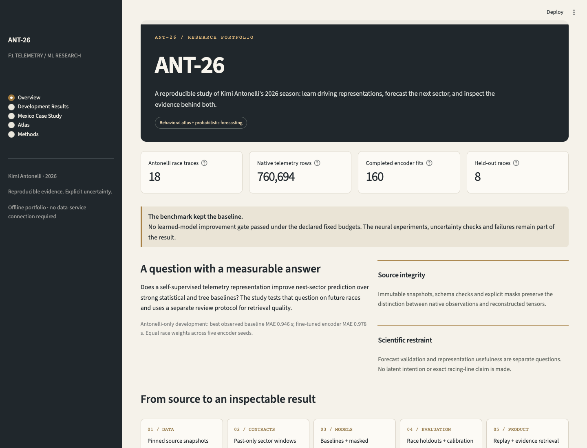

# ANT-26

[](https://github.com/yehosuah/ANT-26/actions/workflows/ci.yml)

**Can a short telemetry history improve the next-sector forecast?** ANT-26 studies Kimi Antonelli's 2026 season with masked sequence learning, calibrated quantile forecasts, and an experimental behavioral atlas.

The benchmark retained CatBoost. The project includes 160 representation fits, a complete research pipeline, an offline portfolio application, and a Mexico case study that preserves a failed first attempt and its implementation correction.



## Try the portfolio

Requires Python 3.11 and [uv](https://docs.astral.sh/uv/). From a fresh checkout:

```bash
make install
make demo
```

Open `http://127.0.0.1:8501`. The five pages work with committed aggregate results. No API, provider credentials, downloaded telemetry, trained weights, or GPU is required. `docker compose up --build` also starts the portfolio and read-only API.

Watch the [short recorded walkthrough](docs/walkthrough.md), or browse the [v0.1.0 release](https://github.com/yehosuah/ANT-26/releases/tag/v0.1.0).

The API-backed artifact viewer remains available through `streamlit run app/replay.py` after starting `ant26 serve`. Local immutable Mexico artifacts add individual forecasts and experimental neighbors to the portfolio; the public checkout shows real aggregate evidence and full lap accounting.

## What the evidence says

| Evidence | Result |
|---|---|
| Development data | 18 Antonelli races, 17 scoreable Russell races; 760,694 native telemetry rows |
| Forecast dataset | 6,204 observed sectors, 5,008 scoreable examples; Mercedes cohort only |
| Evaluation | Eight chronological whole-race holdouts; five fixed encoder seeds; paired race bootstrap |
| Advanced ML | 559,104-parameter masked patch encoder; scratch, frozen and fine-tuned comparisons |
| Forecast selection | CatBoost WIS 0.629; persistence has lower point MAE, 0.946 s |
| Learned-model outcome | No predictive improvement gate passed; corrected tail failures remain reported |
| Mexico diagnostic replay | 115 scored sectors, 95 abstentions, 3 missing; MAE 0.724 s, WIS 0.505 |
| Local CPU inference | CatBoost p95 0.710 ms; encoder p95 0.360 ms, warm batch-one calls |

Development scores evaluate Antonelli, with model-specific cohorts stated in the [results](docs/development-results.md). The Mexico replay follows a disclosed implementation repair after the original frozen pipeline emitted zero forecasts. It is **post-inspection diagnostic evidence**, not a new independent blind test. All 75 sector origins after lap 46 abstain under the fixed pit-context interpretation; Mexico metrics therefore describe a selective subset.

## Inspect the engineering

- [Mexico case study](docs/mexico-case-study.md): full accounting, source limitations, successful and difficult examples, and the preserved first attempt.
- [Engineering decisions](docs/engineering.md): architecture, learning objective, leakage boundaries, normalization failure and model selection.
- [Development results](docs/development-results.md): complete comparisons, paired intervals, cohort scope and failed gates.
- [Reproduction guide](docs/reproducibility.md): fresh source acquisition through experiments, freeze and offline case scoring.
- [Operational evidence](docs/operations.md): measured preprocessing/inference phases, hardware and warning-only drift diagnostics.
- [Data quality](docs/real-data-quality.md), [data card](docs/data-card.md), [model card](docs/model-card.md), and [evaluation protocol](configs/evaluation-protocol.json).

The [aggregate reports](reports/) contain exact metrics, hashes, 71-lap derived accounting, and the [development invariance audit](reports/development-correction-impact.json). Raw source records, individual forecasts, weights, private review assignments and ratings remain outside Git.

## Reproduce and verify

```bash
make check
make smoke
uv sync --locked --group dev --extra ml --extra app --no-editable
scripts/reproduce-development.sh development --run-id my-source-revision
```

The smoke pipeline is explicitly synthetic integration evidence. The development script fetches real data and runs all 160 fixed-budget fits; it can take time and does not fetch Mexico. A separate verified freeze and explicit final-case opt-in are required. Re-fetching a mutable provider can produce different source bytes and hashes; new revisions become new runs.

CI checks lint, formatting, domain/API types, offline tests, optional CPU ML/UI tests, and API/UI container builds and HTTP health. Tests cover future-record mutations, missing laps, unresolved pit exits, source reconstruction, artifact corruption, freeze boundaries, censoring and UI use without private assets.

## Research limits

OpenF1 provides sampled telemetry, not exact racing lines. A 4 Hz tensor grid adds no native resolution. Sector entries and historical availability are reconstructed; verified live-publication latency is unavailable. The observed population is Antonelli and Russell, and it cannot separate driver behavior from the car, setup and strategy.

Continuous atlas retrieval remains experimental with **zero human ratings**. Cluster stability failed, so discrete driving-state claims were removed. The [blind review protocol](docs/atlas-review.md) remains available for later human evaluation. No result attributes championship success, intent, confidence, or tyre preservation to an embedding.
