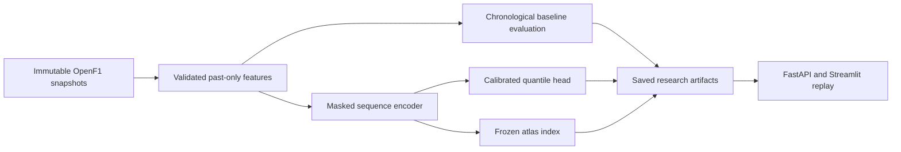

# ANT-26

ANT-26 combines a behavioral telemetry atlas and probabilistic next-sector prediction to study Kimi Antonelli's 2026 Formula 1 performances. Mexico 2026 is reserved for the final case study.

The implementation is in progress. Source ingestion, past-only features, baseline evaluation, a masked sequence encoder, calibrated quantile forecasts, frozen retrieval indexes, an API and an interactive artifact viewer are implemented. Real-data predictive superiority has not been established.

## Current evidence

- Eighteen verified pre-Mexico races in the development catalog; canceled events excluded.
- Three recent races audited for Antonelli and Russell: 39 successful source queries with 60-second telemetry samples.
- First full trace, Antonelli at Austin: 21,252 telemetry samples; 162 of 164 nominal green-sector opportunities retained by the feature pipeline (98.8%). This measures data coverage, not predictive skill.
- Default encoder: 559,104 parameters. CPU optimization, calibration, artifact round-trips and atlas integration verified on explicitly synthetic fixtures.
- Mexico is excluded from fitting, calibration and reference-index construction. Source publication latency is unobserved; forecasts use documented historical event-time assumptions.

## Run locally

Requires Python 3.11 and uv. The locked core environment supports ingestion, features, baseline evaluation and the API.

```bash
uv sync --locked --group dev --no-editable
uv run --no-sync ant26 protocol-check
uv run --no-sync pytest
uv run --no-sync ant26 smoke --output artifacts/smoke
uv run --no-sync ant26 serve
```

The smoke pipeline uses deterministic synthetic sources. Its forecasts are integration evidence and must not be interpreted as Antonelli performance results. Tests for optional ML components skip when PyTorch is absent.

Install model and UI extras when needed:

```bash
uv sync --locked --group dev --extra ml --extra app --no-editable
uv run --no-sync streamlit run app/replay.py
```

The UI connects to the API at `http://127.0.0.1:8000`. Set `ANT26_API_URL` to use another API address. The API reads saved artifacts without accessing the provider or fitting models.

## Ingest real data

```bash
uv run --no-sync ant26 audit
uv run --no-sync ant26 audit --offline
uv run --no-sync ant26 ingest --sessions 11396 --drivers 12
uv run --no-sync ant26 build --full-traces data/audit/full-trace-progress.json --sessions 11396 --drivers 12
```

Requests are rate-limited and raw responses are immutable and checksummed. Full traces use resumable one-minute chunks. Reusing the same progress file resumes completed requests from cache. Source data and model artifacts remain outside Git.

The CLI also exposes `benchmark`, `train` and `atlas`. Every dataset records its protocol hash. Training validates fitting/calibration scopes before optimization, and atlas construction checks the encoder's exact fitting snapshot. An incomplete real-data benchmark reports insufficient data instead of inventing scores.

## Architecture



## Research and progress

- [Implementation plan](docs/implementation-plan.md) and [execution record](docs/execution.md)
- [Evaluation protocol](configs/evaluation-protocol.json)
- [Source audit](docs/data-audit.md) and [data card](docs/data-card.md)
- [Model card](docs/model-card.md) and [representation experiment](docs/representation-experiment.md)

Remaining gates include full development-data ingestion, chronological five-seed experiments, retrieval review, cluster stability and the frozen Mexico case study. Docker configuration is included; a local image build has not been verified because the development Docker daemon is stopped.
