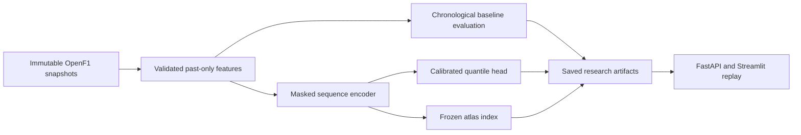

# ANT-26

ANT-26 combines a behavioral telemetry atlas and probabilistic next-sector prediction to study Kimi Antonelli's 2026 Formula 1 performances. Mexico 2026 is reserved for the final case study.

The implementation is in progress. Source ingestion, past-only features, baseline evaluation, a masked sequence encoder, calibrated quantile forecasts, frozen retrieval indexes, an API and an interactive artifact viewer are implemented. Real-data predictive superiority has not been established.

## Current evidence

- Eighteen verified pre-Mexico races in the development catalog; canceled events excluded.
- Full traces for Antonelli's 18 development races and Russell's 17 scoreable races: 760,694 native telemetry rows. Russell's Belgian race has no complete timed lap and is explicitly excluded.
- The declared Mercedes cohort contains 6,204 observed sector examples and 5,008 scoreable forecasts. This is a two-driver cohort, not a full-grid dataset.
- Eight-race baseline backtest: persistence MAE 0.946 seconds; CatBoost weighted interval score 0.629 with 93.0% coverage for its 90% intervals. These describe Antonelli forecasts trained with the Mercedes cohort; learned-model improvement remains unestablished.
- Hungary has substantial out-of-range brake/throttle data. Fixed masking rules retain only 13.6% of its observed nominal origins; the report exposes the selection rather than hiding it.
- Default encoder: 559,104 parameters. CPU optimization, calibration, artifact round-trips and atlas integration verified on explicitly synthetic fixtures.
- Mexico is excluded from fitting, calibration and reference-index construction. Source publication latency is unobserved; forecasts use documented historical event-time assumptions.

## Run locally

Requires Python 3.11 and uv. The locked core environment supports ingestion, features, baseline evaluation and the API.

```bash
uv sync --locked --group dev --no-editable
uv run --no-sync ant26 protocol-check
uv run --no-sync pytest
uv run --no-sync ant26 smoke --output artifacts/smoke
uv run --no-sync ant26 serve
```

The smoke pipeline uses deterministic synthetic sources. Its forecasts are integration evidence and must not be interpreted as Antonelli performance results. Tests for optional ML components skip when PyTorch is absent.

Install model and UI extras when needed:

```bash
uv sync --locked --group dev --extra ml --extra app --no-editable
uv run --no-sync streamlit run app/replay.py
```

The UI connects to the API at `http://127.0.0.1:8000`. Set `ANT26_API_URL` to use another API address. The API reads saved artifacts without accessing the provider or fitting models.

## Ingest real data

```bash
uv run --no-sync ant26 audit
uv run --no-sync ant26 audit --offline
uv run --no-sync ant26 ingest --all-development --drivers 12 63 --progress data/audit/bulk-progress.json
uv run --no-sync ant26 materialize --drivers 12 63
```

Requests are rate-limited and raw responses are immutable and checksummed. Full traces use CSV snapshots with preserved raw bytes and explicit numeric normalization; one-minute JSON chunks remain a fallback. Austin's 96 JSON chunks and one CSV request matched all 21,252 rows exactly. Reusing the same progress file resumes completed requests from cache. Materialization pins exact snapshots and feature-code checksums. Source data and model artifacts remain outside Git.

Use the path emitted by `materialize` with `benchmark`, `representation-benchmark`, `diagnose`, `train` and `atlas`. Every dataset records its protocol hash. Training validates fitting/calibration scopes before optimization, and atlas construction checks the encoder's exact fitting snapshot. An incomplete real-data benchmark reports insufficient data instead of inventing scores.

Constant fitted columns use unit scale under the versioned normalization policy. Regression tests guard against amplified out-of-distribution inputs; the loader rejects checkpoints using the superseded policy. Invalidated experiments are kept for audit and excluded from replay.

## Architecture



## Research and progress

- [Implementation plan](docs/implementation-plan.md) and [execution record](docs/execution.md)
- [Evaluation protocol](configs/evaluation-protocol.json)
- [Source audit](docs/data-audit.md) and [data card](docs/data-card.md)
- [Real-data quality review](docs/real-data-quality.md)
- [Model card](docs/model-card.md) and [representation experiment](docs/representation-experiment.md)

Remaining gates include the corrected chronological five-seed experiments, retrieval review, cluster stability and the frozen Mexico case study. Full-grid expansion remains separate from the initial Mercedes cohort. `docker compose up --build` starts the API on port 8000 and UI on port 8501; GitHub CI verifies both containers. The local Docker daemon is stopped.
