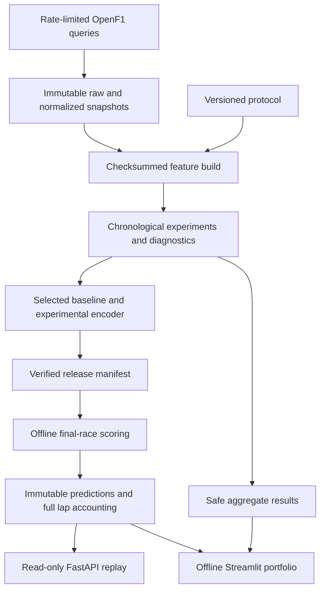

# Engineering the experiment

ANT-26 asks whether a short observed telemetry history helps predict the next sector, and whether the same representation retrieves useful historical comparisons. These are separate questions. The forecasting experiment did not pass its improvement gates. The encoder remains an experimental retrieval component.

## Learning problem

Each origin reconstructs a sector entry from the provider's lap start and completed sector durations. A one-second guard separates that origin from the latest allowed input. The feature window contains 32 seconds of speed, throttle, brake, RPM and gear, aligned to a 4 Hz grid with explicit masks. Interpolation across a permitted short gap does not create additional source resolution. Original publication latency is unknown, so the system evaluates historical event-time replay.

The 559,104-parameter encoder packs eight time steps into each of sixteen tokens, projects values and validity masks to width 128, and applies four transformer layers with four attention heads. Masked pooling produces a fixed-width embedding. Pretraining reconstructs withheld patches with smooth-L1 loss for continuous channels and cross-entropy for brake and gear. Missing or padded values never become reconstruction targets. This is a compact adapted model, not a reproduction of [PatchTST](https://arxiv.org/abs/2211.14730).

The forecasting head combines the embedding with past-only race context and estimates five quantiles of log(sector duration / historical reference). Positive softplus offsets around the median prevent quantile crossing. Pinball loss fits the head; held-out preceding races provide empirical interval widening. Temporal dependence and circuit shift prevent an exchangeability guarantee.

## Where leakage can enter

Entire race weekends, including both drivers, stay outside fitting when held out. Normalization, pretraining, feature PCA, calibration and retrieval references have explicit disjoint scopes. No full-session normalization or test-time index update occurs. Prefix mutation tests change future telemetry and target records and require earlier inputs to remain identical.

The evaluation unit is a race. Eight chronological test races and five fixed training seeds support paired race-block bootstrap intervals; neither telemetry rows nor seeds count as independent races. Model selection uses development results. Mexico is a later one-race case study, with an explicit acknowledgement of prior exploratory inspection.

## Infrastructure choices

Raw responses preserve original bytes and normalized checksums. Feature caches include the feature-builder source hash. Model bundles pin fitting/calibration scopes, exact fitting examples, schema and source identities. The baseline uses validated JSON and native CatBoost files. The encoder loader rejects superseded normalization policies. A release manifest freezes the artifacts and scoring implementation before final-race access.

The public checkout contains code and aggregate evidence. Raw telemetry, trained weights, private review assignments and ratings remain excluded. The portfolio reads aggregate reports without a provider connection, API server or trained model. Full reproduction requires fetching source snapshots; new provider revisions can produce different hashes and must become a new run.

## The failures are part of the result

The first normalization implementation amplified exact-constant context columns. Those experiments were invalidated, preserved and excluded from replay. The corrected policy uses unit scale for nearly zero fitted variance. Corrected pooled experiments still exposed large forecasts under a near-constant feature shift. That is a model failure rather than evidence of superiority. CatBoost was retained for its interval score, with its point-error tradeoff reported.

Cluster stability also missed the declared target. Discrete driving-state labels were removed. Continuous neighbors are shown with context and source identities, while human usefulness remains unvalidated. A portfolio should make these decisions inspectable and reproducible.
