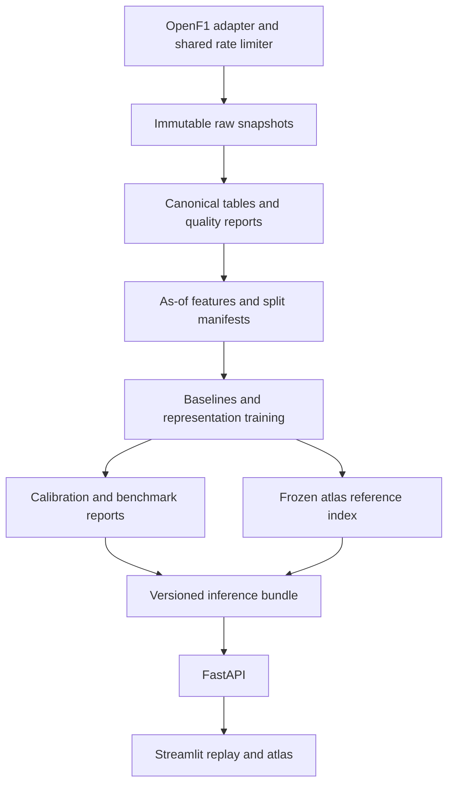

# ANT-26 implementation plan

ANT-26 will learn representations of observed driving execution, use those representations to forecast the next sector, and explain Antonelli's 2026 performances through an interactive behavioral atlas. Mexico is the final case study. The portfolio should let an ML engineer inspect the data lineage, reproduce the benchmark, understand the architecture, and verify the limits of each conclusion.

Planning date: November 1, 2026, America/Guatemala. Status: implementation in progress; see [execution record](execution.md) for measured evidence. Thresholds below are acceptance criteria, not measured results. Machine-readable defaults live in [evaluation-protocol.json](../configs/evaluation-protocol.json).

## Outcome and scope

The final deliverable is a reproducible research repository, a containerized replay application, a technical report, and a short demonstration. Its central research claim will be tested explicitly: do learned telemetry representations improve Antonelli's next-sector forecasts over strong tabular and statistical baselines?

The atlas provides a second, descriptive output: recurring execution patterns and comparable historical examples. Its clusters are inferred patterns, not ground-truth labels for driver intention.

Use verified 2026 Grand Prix race sessions through Mexico. Earlier 2026 races provide training and development data for all available drivers. Antonelli is the primary evaluation subject. Mexico's entire weekend, for every driver, is excluded from pretraining, fitting, tuning, calibration, feature learning, reference geometry construction, clustering, and retrieval-index construction. Future 2026 races are outside version 1. Practice, qualifying, sprints, 2025 transfer learning, radio, and video are possible later extensions.

The November 1 race report confirms Antonelli clinched the championship with third place in Mexico. This is narrative context, not a target label or evidence that a driving pattern caused the title. [Official race report](https://www.formula1.com/en/latest/article/antonelli-crowned-youngest-ever-f1-champion-as-verstappen-wins-eventful-mexico-city-grand-prix.xpMMeef0KmRURs9IDs3LH).

## Source and feasibility

OpenF1 is the primary provider. Historical access is unauthenticated; the current free tier permits 3 requests per second and 30 per minute. Default ingestion should be more conservative, at no more than 25 per minute, with backoff and a shared rate limiter. Direct FastF1 access is optional because its October 2026 release documents an F1TV Access account requirement. [OpenF1 access](https://openf1.org/), [FastF1 release](https://github.com/theOehrly/Fast-F1/releases/tag/v3.9.0).

Use `sessions`, `meetings`, `drivers`, `laps`, `car_data`, `stints`, `intervals`, `position`, `weather`, `race_control`, and `pit`. Location is optional for the map and alignment diagnostics. Car data is sampled at approximately 3.7 Hz, location does not reliably preserve lateral placement, and lap start timestamps are approximate. These constraints determine the granularity of the product. [OpenF1 API documentation](https://openf1.org/docs/).

The exploratory checks preceding this plan found Antonelli under driver number 12 and Mexico race session 11404, meeting 1298. One response contained 70 lap records with lap 5 absent, although the race covered 71 laps. A lap-10 window returned 297 car samples and 327 position samples. These observations are feasibility evidence, not a frozen benchmark dataset; archive fresh responses and their checksums in M1.

Session 11731 paired country `Bahrain` with circuit `Kuala Lumpur`. M0 resolved it against the official calendar as the Bahrain GP in Malaysia at Sepang; a sourced override preserves raw fields while supplying the canonical venue. Continue quarantining unresolved identities and exclude canceled sessions. [Official event page](https://www.formula1.com/en/racing/2026/bahrain).

## Prediction contract

For driver d entering sector s of lap l, forecast that sector's duration in seconds. Emit the median plus 80% and 90% prediction intervals. This is historical replay under event-time assumptions; source responses do not establish when every field originally became available to a live consumer.

Construct a sector-entry timestamp from the approximate lap start and durations of already completed sectors: S1 uses lap start, S2 adds S1 duration, and S3 adds S1 and S2 durations. The feature cutoff is one second before that reconstructed entry. Build features only from samples and completed events at or before the cutoff. Repeat evaluation with 0.5-second and 2-second guards as timing-sensitivity analyses.

The current sector's duration, remaining sector durations, full current-lap duration, current-lap speed traps not yet crossed, final position, final stint length, and future weather or flags are target-only or unavailable fields. A historical lap row contains future information even when some fields describe earlier events. Expose an explicit allowlist through an as-of feature builder; never pass complete lap rows to prediction code.

The time anchor itself is reconstructed using completed-sector timing, so it is an approximation with potential alignment error. Declare its provenance in every prediction. Tyre metadata and other retrospective records without original publication timestamps use documented event-time assumptions. Validate anchors against successive laps and session-status events in M2; quarantine inconsistent examples. If model gains disappear under the larger timing guard, report that sensitivity rather than a reliable timing advantage. The system must not claim measured live latency or exact live availability.

A forecast is eligible when the most recent flag and pit observations available at the cutoff indicate green running outside the pit lane, the input passes quality checks, and at least two previous valid observations of that driver's same sector in the current race exist before the cutoff. Use the median of the last three available observations as a reference duration. Cold starts receive an explicit abstention. Recent in-race history may update features in held-out races; weights, normalizers, calibration parameters, and retrieval references remain frozen. The nominal green-sector retention denominator uses this same cutoff information, before input-quality and history requirements are applied.

Train the learned head to predict log duration relative to the reference, then convert predictions to seconds. Unknown circuits use an unknown-category token plus observed in-race history, avoiding dependence on a circuit embedding seen during training. A 2026 circuit normally appears only once, so circuit generalization must be assessed explicitly.

Score all eligible forecasts with valid duration targets, including sectors unexpectedly slowed by later yellow flags or Safety Cars. Also report a separate uninterrupted-green subset. Target-spanning red flags, invalid timing, and censoring receive explicit exclusion reasons and counts; never silently drop large errors. Primary and baseline models use identical origin and target eligibility rules.

## Data model and quality

Store original JSON responses immutably with endpoint, query, UTC retrieval time, provider, schema version, and SHA-256 checksum. Store canonical tables in Parquet. Identify sectors by session, driver, lap number, and sector index; identify source samples by provider, session, driver, timestamp, and preserved duplicate identity where necessary.

Canonical datasets comprise event catalog, raw telemetry, lap and sector timing, race context, aligned windows, forecast examples, and immutable predictions. Each forecast example records origin, cutoff, label interval, context timestamps, input-quality measures, exclusions, split identifier, and source references.

Build 32-second input windows on a 4 Hz tensor grid for convenience. This grid adds no physical resolution. Preserve observation masks, sample age, and original timestamps. Fit scaling only on fitting data. Do not interpolate across gaps longer than one second, lap interruptions, or red flags. Continuous interpolation may only use observations already available by the cutoff; categorical channels use bounded previous observations. Require at least 80% observed or permitted short-gap coverage for each required channel.

Required sequence channels are speed, throttle, brake application, RPM, and gear. Encode missingness and elapsed time. DRS is optional and excluded from version 1 model inputs because 2026 semantics and availability differ. Do not infer ERS deployment, steering angle, brake pressure, tyre temperature, or actual cornering lines from absent channels. Derived throttle and braking summaries retain the provider's channel definitions.

Validate unique keys, monotonic timing, sector sums against lap duration, overlap with pit or flag intervals, duplicates, missing laps, and frozen or implausible multichannel sequences. A constant speed alone is not proof of corruption. Record rejection reasons and retention by race, driver, and race phase. Initial thresholds may be revised using development data before protocol lock, with versioned reasons; Mexico cannot drive those choices.

## Architecture



Use a Python package managed by uv, DuckDB over Parquet for inspection, PyTorch for sequence models, CatBoost for the tree baseline, scikit-learn for PCA and clustering, and MLflow for experiments. FastAPI serves artifacts and inference; Streamlit calls that API. Docker Compose runs the local demo. GitHub Actions checks the package using small fixtures. Pin actual dependency versions when implementation begins.

Keep the domain layer independent of HTTP, model frameworks, and UI code. Provider adapters produce canonical records. Pure feature functions serve both offline training and inference. Model and calibration artifacts load through a small inference interface. The app reads predictions and references; it does not fit models.

Planned package layout:

```text
src/ant26/
  domain/          # schemas, identity, timing and eligibility rules
  ingestion/       # provider adapters, cache, retries and manifests
  datasets/        # quality, alignment, splits and as-of feature builder
  models/          # baselines, encoder and forecast head
  atlas/           # reference index, pattern descriptions and retrieval
  evaluation/      # metrics, calibration, ablations and report generation
  serving/         # inference bundle and FastAPI routes
  cli.py
app/               # Streamlit client
configs/           # versioned data, training and evaluation configuration
tests/             # fixtures, domain tests and pipeline integration checks
docs/              # architecture, data card, model card and case study
data/              # ignored raw and processed artifacts
```

Proposed CLI stages are catalog, ingest, validate, build, baseline, train, evaluate, atlas, and replay. They are milestone deliverables, not commands available today. Each stage accepts a manifest and produces a new versioned manifest. Re-running a completed ingestion must reuse the snapshot; refresh creates a new version.

## Model sequence

Start with same-sector persistence, reference-duration prediction, a regularized linear residual model, and CatBoost quantile models over historical features. Apply comparable interval calibration and the same evaluation set to all models. These establish whether the sequence data adds useful information.

The first deep candidate is a small patch-based sequence encoder, initially four layers with width 128 and four attention heads, kept below two million trainable parameters. Pretrain by masking observed telemetry patches and reconstructing them. Reconstruct continuous channels with a robust regression loss and discrete channels with classification losses; never reward reconstruction of padded or missing entries. Masked patch learning is motivated by [PatchTST](https://arxiv.org/abs/2211.14730); this adapted multichannel design is not a claim to reproduce the paper.

Pool the encoder output, combine it with past-only context, and train a non-crossing quantile head at probabilities 0.05, 0.10, 0.50, 0.90, and 0.95. Compare a frozen encoder, fine-tuning, and the identical architecture trained from scratch. A contrastive encoder motivated by [TS2Vec](https://arxiv.org/abs/2106.10466) is a stretch experiment only after the first candidate is evaluated.

Use equal driver sampling for training, and balance overlapping windows so long sessions do not dominate pretraining. Track the independent race count as well as rows and windows. Limit the initial encoder search to eight configurations, 30 pretraining epochs, and 50 fine-tuning epochs with early stopping on tuning data. Record actual GPU-hours, peak memory, inference latency, and dataset size. Stop or simplify if compute exceeds the budget agreed before M4; the plan assumes access to one local or rented modest GPU without authorizing spending.

For the atlas, use embeddings from the frozen pre-Mexico encoder and a reference index containing only fitting-period examples. Fit a Gaussian mixture with 3 to 8 components, selected on development data for stability and retrieval utility. Compare against standardized hand-built features with PCA and nearest-neighbor retrieval. A two-dimensional projection is a navigation aid, not evidence of distinct driving styles.

Validate retrieval within the chronological folds: build each reference index and encoder from that fold's fitting data, and take queries from its test race. Never evaluate an earlier held-out query with the final encoder if that encoder was subsequently fitted on the query's race. Remove overlapping windows and same-lap duplicates from reference candidates. Freeze the final pre-Mexico index only after these development checks.

Describe clusters through observable differences and representative traces. Report how strongly representations encode circuit, driver, team, and tyre compound; do not claim identity disentanglement. Use within-context comparisons where possible and label unsupported comparisons. If clusters are unstable or dominated by track identity, retain continuous retrieval and drop discrete state claims.

## Evaluation and decision gates

Resolve and sort verified pre-Mexico races as R1 through RN. For each rolling test race Ri with i at least 11: fit on R1 through R(i-5), tune on R(i-4) and R(i-3), calibrate on R(i-2) and R(i-1), and test on Ri. After selecting hyperparameters, refitting on fitting plus tuning races is allowed before calibration. At least six usable pre-Mexico test races are required for the intended benchmark; otherwise label estimates exploratory and narrow claims.

All drivers and sessions from a held-out weekend remain outside learned fitting steps. No random window splits, transductive pretraining, full-session normalization, future geometry extraction, or retrieval-index updates from test data. Dynamic reference durations and past-only context are allowed to update during replay.

For the final Mexico run, tune on the third- and fourth-most-recent verified pre-Mexico races, calibrate on the final two, and fit on all earlier races. Refit on fitting plus tuning races with selected hyperparameters, then calibrate. Freeze the model bundle, protocol, thresholds, index, code revision, and data manifests before running Mexico. Development backtests are model-selection evidence; Mexico is a one-race external case study, not a new multi-race generalization estimate.

| Dimension | Measurement and proposed gate |
|---|---|
| Primary forecast subject | Antonelli; average error within each race, then equally across races. Publish valid forecast counts and coverage. |
| Point forecast | MAE in seconds plus error normalized by the historical reference duration. Target at least 5% lower race-macro MAE than the strongest development-selected baseline. |
| Probabilistic forecast | Weighted interval score using the median and central 80% and 90% intervals. Target at least 5% lower race-macro score than the strongest baseline selected for this metric. |
| Statistical support | Five training seeds; 1,000 paired bootstrap resamples by race, retaining complete race blocks. Report 95% intervals; an interval crossing zero makes improvement inconclusive. |
| Calibration | Target pooled 90% interval coverage between 87% and 93% on development backtests. Publish interval width, race-level coverage and counts; this tolerance is an engineering target, not a guarantee under circuit shift. |
| Atlas retrieval | At least 60 fixed development query comparisons across six races. Review model versus feature-baseline neighbors without model identity. Target at least 60% model preference; report ties, confidence intervals, and reviewer count. One reviewer makes this exploratory. |
| Pattern stability | Bootstrap training races and compare cluster assignments on a fixed development probe set. Target median adjusted Rand index at least 0.6. Failure removes discrete pattern labels. |
| Data retention | Target at least 70% of nominal green-sector opportunities for Antonelli in at least six development test races. Explain every loss from the denominator; this is separate from forecast accuracy. |
| Reliability | No duplicate canonical keys; every origin passes the cutoff invariant; schema changes fail visibly; no hidden network calls during offline replay. |
| Serving | CPU batch-of-one inference p95 below 200 ms after warm-up on declared hardware; measure model preprocessing and inference separately from UI/network time. |

Baseline selection occurs without Mexico. Evaluate point and interval gates against their respective strongest baselines. Publish the same fixed seeds and folds even when results disappoint. A completed, reproducible negative result is a valid research outcome; an advanced-model improvement claim requires passing its gates.

Publish each seed separately and summarize paired race-level improvement after averaging errors across the fixed seeds; seeds do not count as independent races in the bootstrap. Use seed 17 for the final deployable candidate, fixed in advance, and show its individual backtest scores alongside the multi-seed summary. If a baseline is deployed instead, the representation experiment and atlas retain their own validation results.

Run ablations for pretraining, sequence input, race context, driver conditioning, timing guard, and quality filtering. Keep quality-filtering ablations diagnostic and never silently replace the primary validity rules. Report error and abstention by race, sector, tyre age, traffic band, restart proximity, and input quality. Sparse slices show counts and uncertainty rather than ranked conclusions.

Post-hoc conformal adjustments may use only the designated preceding calibration races. Report empirical coverage and explicitly acknowledge serial dependence and distribution shift. Future flags are not forecast inputs; surprise interruptions stay visible in operational metrics.

## Milestones

Each milestone is owned by the implementer, ends with the listed evidence, and must clear its gate before dependent work. Estimates assume one engineer; approximately 6 to 8 full-time weeks overall, with data or model failures potentially extending the schedule. No deadline or GPU budget has been committed.

| Milestone | Estimate | Concrete deliverable and exit gate | Depends on |
|---|---|---|---|
| M0 Lock the research contract | 1 day | Resolve event identities and exclusions; record provider terms, compute assumption, target and split policy; version the protocol. | None |
| M1 Ingest and audit | 3 to 4 days | Snapshot three development races first, then verified pre-Mexico races; produce channel reports and provisional retention estimates. Mexico stays quarantined. Clear source feasibility. | M0 |
| M2 Build past-only inputs | 4 days | Canonical tables, sector anchors, quality masks, as-of feature builder and split manifests; verify final retention targets. Mutation tests show changing any future record leaves earlier features unchanged; missing-lap and red-flag fixtures pass. | M1 |
| M3 Establish baselines | 3 days | Rolling benchmark, calibrated intervals, dataset card and error slices. Publish a baseline report with zero leakage violations and a reproducible offline run. | M2 |
| M4 Train representations and forecast | 5 to 7 days | Masked encoder, scratch/frozen/fine-tuned comparisons, five-seed results and measured compute. Apply predictive gates; retain the stronger baseline if gates fail. | M3 |
| M5 Build the behavioral atlas | 4 to 5 days | Frozen historical reference index, observable pattern summaries, retrieval review and stability report. Use continuous retrieval if state labels fail. | M4 |
| M6 Integrate the portfolio application | 4 to 5 days | API, replay UI, container images, CI, observability, and an offline end-to-end fixture. Provenance visible on every prediction and retrieved example. | M3, M5 |
| M7 Freeze and publish the Mexico case study | 3 to 4 days | Freeze pre-Mexico bundle, run Mexico once, explain all eligible and excluded phases, produce report/model card/demo. All findings trace to immutable predictions. | M6 |

- [x] M0 Research contract locked
- [x] M1 Initial Mercedes cohort audited; full-grid expansion remains open
- [x] M2 Inputs and leakage tests complete
- [x] M3 Initial cohort baselines reproduced
- [x] M4 Learned models evaluated; baseline retained after failed improvement gates
- [ ] M5 Atlas validated
- [x] M6 Application integrated and API/UI container checks passed
- [ ] M7 Mexico case study complete

## Mexico case study and demo

Prior exploratory inspection already exposed Mexico's outcome, some metadata, and a short telemetry window. Describe it as a case study with no fitting or model selection on Mexico; do not call it an untouched blind benchmark. Only completeness, schema, and event identity checks may inspect quarantined Mexico data before model freeze, and every such inspection must be logged.

Predeclare case-study chapters: the opening soft-tyre stint; the pit and red-flag interruption; execution after the standing restart; the late Safety Car and final run. Use official event reports to locate chapters, and source timing to anchor them. Investigate whether telemetry patterns change; allow the answer to be that evidence is insufficient. The race report establishes these events, not their behavioral causes. [Official race narrative](https://www.formula1.com/en/latest/article/antonelli-crowned-youngest-ever-f1-champion-as-verstappen-wins-eventful-mexico-city-grand-prix.xpMMeef0KmRURs9IDs3LH).

Show the complete 71-lap timeline, including missing records, neutralized periods, abstentions, and invalid targets. Display sampled telemetry, forecast medians and intervals, realized durations, prediction residuals, context, and input quality. Retrieved comparisons come only from the frozen pre-Mexico reference index and show why their context is comparable or different.

The application exposes two distinct modes. Forecast replay only displays outputs built from prefixes available at each cutoff. Retrospective atlas analysis may describe a completed sector once observed; it is clearly marked as retrospective and never feeds that sector's forecast. No retraining, recalibration, or neighbor-index fitting occurs during Mexico replay.

Deliver a 3 to 5 minute recorded walkthrough, a concise technical article, reproducible benchmark commands, a data card, a model card, and exported prediction tables. Include one successful example, one difficult failure, and one abstention. Show that UI values match the immutable prediction table. A polished story must not replace the full error accounting.

No claim should attribute championship success, confidence, tyre preservation, or racecraft to a cluster or residual alone. Russell is a useful comparison with explicit setup, strategy, mechanical, and fuel limitations. The final narrative describes observed execution and model behavior.

## Verification and release

Test the failure modes that can invalidate results: future-record leakage, unknown circuits, interrupted sectors, missing laps, stale context, interval crossing, disjoint split manifests, duplicate ingestion, artifact mismatches, and API serialization. Include a small offline integration fixture that flows through canonicalization, features, a baseline, evaluation, API response and UI consumption. Do not require provider access in CI.

Log ingestion counts, quality exclusions, forecast and abstention counts, artifact hashes, latency, calibration summaries and drift diagnostics. A structured prediction response includes model version, data version, origin, cutoff, median, quantiles, eligibility, timing assumption and source references. Atlas responses additionally include index version and retrospective status.

Pin environments and seeds. Require formatting, type checks, relevant unit/integration checks, and a secret scan before release. Keep large data and models outside Git. Publish the code and fetch/reproduction instructions; check the provider's actual rights before redistributing datasets. OpenF1's free access is intended for personal, educational and research uses; public data redistribution and other uses need a separate rights assessment. [Provider use guidance](https://openf1.org/).

Public deployment, account creation, purchases, and external publication are later release actions, not authorized or performed by this planning document. A local reproducible demo is the default deliverable.

The first implementation task is M0 followed by a three-race development ingestion audit. Do not start representation training until timing validity, source completeness and the baseline evaluation path are demonstrated.
