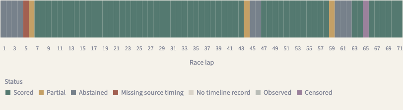

# Recovering Mexico coverage with a report-time pit policy

The new diagnostic replay recovers **62 scoreable sectors on laps 47–71**, where the published v0.1 replay scored none. It retains every one of the earlier 115 scored sectors. All 213 slots now reconcile to **177 scored, 32 abstained, one censored target and three missing sectors**. The original zero-forecast attempt and 115-forecast correction remain unchanged.

The [new case report](../reports/mexico-case-study-pit-v0.2.0.json), [cohort comparison](../reports/pit-policy-comparison.json) and version selector in the portfolio expose both versions. This remains post-inspection diagnostic evidence, with revised development data and refitted artifacts. It is not a new independent test or a claim that the neural forecast head improved.

## Resolved interpretation and its limit

The prior policy started an interval at OpenF1 `date` and added `lane_duration`. The long red-flag stop therefore appeared to occupy almost the entire remainder of the race, including thousands of high-speed telemetry observations.

Primary upstream code copies a feed/message timestamp into `date`; the public API documentation does not define an exact physical entry/exit loop. Official pit-stop timing, cached pit-out lap anchors and speed traces support a **completion/report-time proxy**. Subtracting the duration aligns with the normal stop and red-flag wait. Source offsets and one development anomaly prevent an exact-physical-boundary claim. The [evidence memo](pit-timestamp-evidence.md) pins upstream commits, calculations and primary-source links.

Protocol [v0.2.0](../configs/evaluation-protocol-pit-v0.2.0.json) declares `completion_report_v2`:

1. At each cutoff, admit only pit records with their original `date <= cutoff`.
2. For a finite, nonnegative duration, derive approximate past occupancy as `[date − lane_duration, date]`.
3. Use that interval to assess completed historical references only after the report is admitted. A known completed report no longer extends pit occupancy into the future.
4. Preserve conservative completed-running-lap evidence for unknown durations.

The order is essential. A later report cannot affect an earlier origin merely because subtraction places inferred entry before that origin. Future-record mutation and exact-boundary tests enforce this. A missing policy declaration retains the legacy rule; an independent offline rebuild reproduced all 6,204 legacy examples exactly.

Report date is an availability proxy, not verified API publication time. The source lacks an earlier observed `InPit` signal and field-version arrival timestamps. Consequently, this policy cannot reliably detect a new pit entry before its completion report, and backward-derived intervals can have feed offsets. These limits remain explicit in forecasts and comparisons.

## Rebuild rather than reuse old weights

The revised development cohort uses the same 35 cached driver-race traces and unchanged target labels. It has 5,264 eligible origins and 5,249 scoreable examples, compared with 5,018 and 5,008 previously. Of 6,204 examples, 1,638 have changed inputs; the remaining 4,566 changes are provenance only. There are 246 eligibility gains and no losses. [Development impact audit](../reports/pit-policy-development-impact.json), [legacy compatibility proof](../reports/pit-policy-legacy-compatibility.json).

Changed fitting and calibration rows require new normalization, models, calibration and reference index. The eight-race baseline benchmark was rerun with fixed settings. CatBoost was again selected by development WIS: MAE 0.908812 s, WIS 0.580976 and 90% coverage 92.43% across 1,137 Antonelli forecasts. These changed-population scores are descriptive; they are not paired improvements over v0.1. [New baseline report](../reports/pit-policy-development.json).

Final artifacts retain seed 17, the first 16 races for fitting, and Singapore/Austin for calibration. The separate encoder retains its architecture and three/five epoch budgets; the new index has 4,568 fitting references. The historical 160 neural experiment results remain attached to v0.1, without borrowing their validation for the new encoder.

The new freeze at `e18292c` pins the v0.2 protocol, new artifacts, evidence and development report. It links the preserved parent freeze/report and enforces the unchanged model recipe and race scopes while explicitly recording changed data and model bytes. Mexico reconstruction and scoring followed this freeze using the exact same nine source snapshots with the client offline.

## Separate coverage from forecast quality

| Population | Scored | MAE seconds | WIS |
|---|---:|---:|---:|
| Published v0.1 subset | 115 | 0.723642 | 0.505067 |
| Same 115 sectors, refitted v0.2 | 115 | 0.720436 | 0.509305 |
| Newly covered late sectors | 62 | 1.164149 | 0.797125 |
| Complete v0.2 scored subset | 177 | 0.875861 | 0.610124 |

On the identical 115 sectors, MAE changes little and WIS is slightly worse. The additional sectors are harder. The overall mean changes its population, so comparing 0.875861 directly with 0.723642 would conflate coverage and forecast quality. Both weights and development data changed; the comparison does not isolate a causal timestamp-policy effect. No one-race confidence interval is manufactured from adjacent sector samples.

Late coverage is 62 of 75 slots, or 82.67%. The remaining 12 late abstentions comprise ten non-green origins and two invalid anchors. One eligible forecast on lap 65, sector 1 is censored for invalid sector timing. Lap 5's three missing records remain missing. Overall scoreable coverage rises from 53.99% to 83.10%; no prior scored sector is lost.



Warm batch-one CPU p95 measured with the new weights is 0.716 ms for CatBoost and 0.372 ms for the encoder, excluding loading, source alignment and network/service latency. [Versioned operations report](../reports/operations-pit-v0.2.0.json).

## Reproduce the revision

Use a fresh output directory for every stage. With the original cached source progress/catalog available:

```bash
ant26 --protocol configs/evaluation-protocol-pit-v0.2.0.json materialize \
  --progress data/audit/bulk-progress.json --catalog data/audit/catalog.json \
  --drivers 12 63 --output data/processed/my-pit-revision
```

Run `benchmark --catboost` and `prepare-release` against the emitted dataset with that same protocol. Freeze with `--feature-revision-record`; its pinned inputs are the parent freeze/report/protocol, primary evidence and new development benchmark, with a concrete description. The existing `--correction-record` route remains stricter and cannot be used to imply unchanged weights here.

Then use `case-ingest --offline`, `case-score`, and `case-export` with the new freeze, protocol and fresh output paths. `compare-pit` checks the saved artifacts and generates an optional aggregate-only export:

```bash
ant26 compare-pit --prior-run artifacts/mexico-case-study \
  --new-run artifacts/mexico-case-study-pit-v0.2.0 \
  --prior-freeze artifacts/releases/ant26-v2-freeze.json \
  --new-freeze artifacts/releases/ant26-v3-pit-freeze.json \
  --output artifacts/my-pit-comparison.json \
  --public-output reports/my-pit-comparison.json
```

Exact historical assets are not bundled. A fresh provider acquisition has new source identities and must become a separately declared run. Published reports, models, indices and the v0.1.0 release are preserved.
