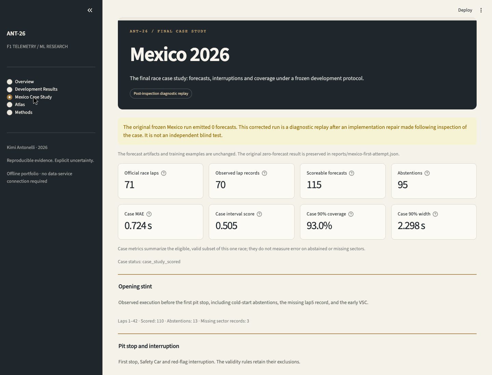
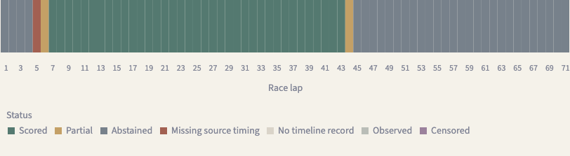

# Portfolio walkthrough

The [release walkthrough](https://github.com/yehosuah/ANT-26/releases/download/v0.1.0/ant26-walkthrough.webm) is a silent screen recording of the aggregate-only application. It requires no private data and shows the same evidence available in a fresh checkout.

1. **Overview:** the research question, audited population, 160 representation fits and decision to retain a baseline.
2. **Development Results:** switch cohorts and MAE/WIS, inspect the model comparison, and preserve failed improvement gates and selective coverage.
3. **Mexico Case Study:** the zero-forecast first attempt, explicit diagnostic correction, 115 scored sectors and 71-lap accounting. Scored errors do not cover abstentions or missing timing.
4. **Atlas:** continuous retrieval remains experimental, with zero human ratings and failed discrete-state stability. Local assets enable individual neighbor inspection.
5. **Methods:** temporal boundaries, immutable artifacts, reproducibility commands and measured warm CPU inference.

Run the application with `make install && make demo`. Detailed forecasts and neighbors require separately generated immutable local assets; the public tour does not substitute synthetic data for them.

